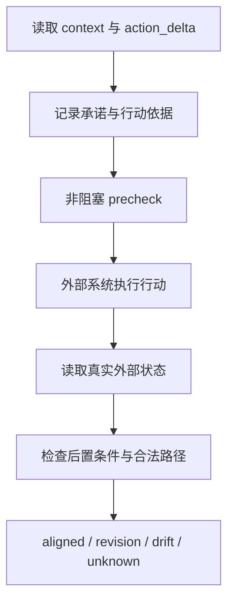

# maintain-consensus-universal v0.2：介绍说明

## 一句话说明

`maintain-consensus-universal` 是一个独立的运行层，用来检查“共同理解是否真的改变了后续行动”，并把行动结果与外部真实状态对应起来。

它把以下信息放进同一个可审计账本：

- 当前 `context` 和最近行动变化 `action_delta`；
- 带来源、作用域、禁止项和要求项的承诺；
- 准备执行的具体行动、决策依据和证据引用；
- 执行后从文件、产物、数据库、工具回执或环境快照读取到的状态；
- 预期后置条件、合法替代路径和实际结果分类。

## 它解决的核心问题

仅仅让 `context` 输出得很完整，不能证明实际操作已经遵守了它。常见的断裂有：

1. 上下文已经更新，但下一步仍重新采用了 `action_delta.do_not_reuse` 中的旧依据；
2. 行动前的描述看起来合理，但没有记录具体要做什么、依据什么以及完成后应出现什么状态；
3. 系统声称“已经完成”，但外部文件、数据库或工具状态并没有对应变化；
4. 实际执行使用了另一条路径，结果正确，却被机械地误判为偏离；
5. 外部来源不可读时，把“没有证据”误算成成功。

统一系统的作用是把这些问题拆开记录，并在行动前后分别检查。

## 它怎样工作

### 1. 把共识变成可检查的行动

`context` 保留目标、用途、约束和行动变化。`action_delta` 记录最近发生了什么、哪些旧依据不能再次使用、哪些基础已经被替代。

统一层不要求每次行动都重新解释整个历史，只要求行动提案明确关联当前 `consensus_version`、决策依据和预期后置条件。

### 2. 把承诺变成可追溯约束

承诺不是一句无来源的规则，而是带有：

- 来源；
- 作用域；
- 禁止项；
- 要求项；
- `active`、`superseded` 或 `retracted` 状态。

这样可以回答“这个行动为什么需要改写”“它触及了哪条承诺”“这条承诺是否仍然有效”。

### 3. 用非阻塞检查发现问题

`precheck` 会返回：

- `consistent`：当前行动与上下文和有效承诺没有已知冲突；
- `needs_restatement`：版本过期、触及禁止依据或违反有效承诺，需要改写行动描述；
- `insufficient_basis`：行动缺少决策依据或可执行后置条件。

这些状态用于记录和提示，不是人工审批，也不会自动替外部系统执行行动。

### 4. 用外部状态验证实际行为

行动完成后，系统根据 `verification_source` 读取外部状态，并对读取到的值执行后置条件检查。可用来源包括：

- 文件或构建产物；
- 只读 SQLite 查询；
- JSON 工具回执；
- 环境变量、目录状态或 JSON 环境快照。

观测输入中的 `observed_postcondition` 不被接受为事实。文字自报只能作为线索，不能替代外部状态读取。

### 5. 区分正确替代、合理修订和漂移

| 分类 | 含义 |
|---|---|
| `aligned` | 外部后置条件通过，且实际行动相同或使用了声明的合法路径 |
| `justified_revision` | 实际行动改变，但有证据支持的修订依据，且后置条件通过 |
| `drift` | 后置条件失败，或行动改变却没有合法路径和证据依据 |
| `unknown` | 外部来源不可读，或无法得到实际行动；不算成功 |

这个分类保留了一个关键区别：路径可以不同，但只要结果满足目标且变化在预先声明的范围内，就不应被误判为漂移。

## 它的价值

### 把“理解一致”连接到“行动一致”

系统不只记录模型说了什么，而是把“拟定行动 → 实际执行 → 外部状态”连接起来。这样可以观察共识更新是否真的改变了选案、指标和下一步行动。

### 降低误报和漏报

外部后置条件避免把完整字段、漂亮叙述或模型自报当成完成证据。合法路径和证据支持的修订又避免把所有行动差异都错误归类为失败。

### 保留探索自由

统一层默认不增加人工审批闸门。它记录冲突、缺口和结果，让执行者可以重述行动、切换路径或继续探索；是否执行仍由外部流程决定。

### 支持复查和重复运行

账本包含版本、事件、完整性摘要和验证历史，可以追溯一次行动如何被提出、检查、验证和分类。`pass@1` 与 `pass^k` 可用于观察单次成功率和重复运行可靠性。

## 边界和正确定位

- 这是冻结 maintain-consensus v0.4 之外的独立扩展，不能改写冻结核心或冻结实验。
- 它不负责替代数据库、工具或部署系统执行动作。
- “自动读取”是根据声明的来源类型选择读取器，不等于扫描主机上所有未知服务。
- 当前内置数据库读取器是只读 SQLite；其他数据库需要增加对应适配器。
- `unknown` 是诚实的不确定性记录，不是成功，也不是自动失败。
- 通过这些检查只能证明某次行动与外部状态的关系，不能单独证明模型整体能力已经提高。

## 适合的使用场景

- 需要持续复查“共识更新是否改变后续行动”的长期协作；
- 需要把工具调用与最终数据库、文件或环境状态对应起来的自动化流程；
- 允许多条实现路径，但要求最终状态满足同一目标的任务；
- 需要区分真正漂移、合理修订和暂时无法验证的系统测试。

## 版本关系

| 版本 | 角色 |
|---|---|
| maintain-consensus v0.4 | 冻结核心，保持原样 |
| action-reality v0.1 | 独立验证层的前身 |
| universal v0.2 | 将上下文、承诺、行动前检查、外部状态和结果分类合并后的独立运行层 |
