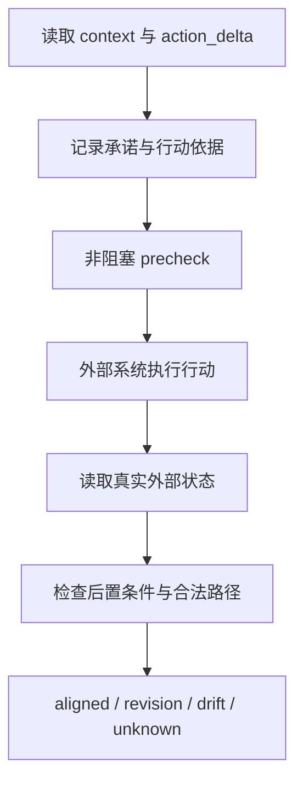

# maintain-consensus-universal v0.3.1：介绍说明

## 一句话说明

`maintain-consensus-universal` 是一个独立的运行层，用来检查“共同理解是否真的改变了后续行动”，并把行动结果与外部真实状态对应起来。

它把以下信息放进同一个可审计账本：

- 当前 `context` 和最近行动变化 `action_delta`；
- 带来源、作用域、禁止项和要求项的承诺；
- 准备执行的具体行动、决策依据和证据引用；
- 执行后从文件、产物、数据库、工具回执或环境快照读取到的状态；
- 预期后置条件、合法替代路径和实际结果分类。

## 它解决的核心问题

仅仅让 `context` 输出得很完整，不能证明实际操作已经遵守了它。常见的断裂有：

1. 上下文已经更新，但下一步仍重新采用了 `action_delta.do_not_reuse` 中的旧依据；
2. 行动前的描述看起来合理，但没有记录具体要做什么、依据什么以及完成后应出现什么状态；
3. 系统声称“已经完成”，但外部文件、数据库或工具状态并没有对应变化；
4. 实际执行使用了另一条路径，结果正确，却被机械地误判为偏离；
5. 外部来源不可读时，把“没有证据”误算成成功。

统一系统的作用是把这些问题拆开记录，并在行动前后分别检查。

## 它怎样工作

### 1. 把共识变成可检查的行动

`context` 保留目标、用途、约束和行动变化。`action_delta` 记录最近发生了什么、哪些旧依据不能再次使用、哪些基础已经被替代。

统一层不要求每次行动都重新解释整个历史，只要求行动提案明确关联当前 `consensus_version`、决策依据和预期后置条件。

### 2. 把承诺变成可追溯约束

承诺不是一句无来源的规则，而是带有：

- 来源；
- 作用域；
- 禁止项；
- 要求项；
- `active`、`superseded` 或 `retracted` 状态。

这样可以回答“这个行动为什么需要改写”“它触及了哪条承诺”“这条承诺是否仍然有效”。

### 3. 用非阻塞检查发现问题

`precheck` 会返回：

- `consistent`：当前行动与上下文和有效承诺没有已知冲突；
- `needs_restatement`：版本过期、触及禁止依据或违反有效承诺，需要改写行动描述；
- `insufficient_basis`：行动缺少决策依据或可执行后置条件。

这些状态用于记录和提示，不是人工审批，也不会自动替外部系统执行行动。

### 4. 用外部状态验证实际行为

行动完成后，系统根据 `verification_source` 读取外部状态，并对读取到的值执行后置条件检查。可用来源包括：

- 文件或构建产物；
- 只读 SQLite 查询；
- JSON 工具回执；
- 环境变量、目录状态或 JSON 环境快照。

观测输入中的 `observed_postcondition` 不被接受为事实。文字自报只能作为线索，不能替代外部状态读取。

### 5. 检查后置条件本身是否足够

只要有一个 `status=completed` 字段，并不代表目标真的实现。v0.3.1 会对后置条件做结构性质量评估：

- 检查数量达到 `min_checks`；
- 检查路径互不重复；
- 至少有值比较，而不是全部使用 `exists`；
- 可以声明必须覆盖的路径、终态字段和效果/身份字段。

质量不足时，行动仍然可以进入账本，但验证结果会是 `unknown`，不能通过为 `aligned`。这是一道防止“检查通过但目标没有实现”的基础门槛。它能发现明显的弱检查，不能替代领域专家对检查语义的判断。

### 6. 判断验证来源是否可信、是否覆盖充分

每个验证来源可以声明：

- `authority`：来源属于哪个系统或权威主体；
- `independence`：是否独立于执行者；
- `mutable_by_executor`：执行者是否可以直接修改来源；
- `max_age_seconds`：允许的最大年龄；
- `coverage`：来源明确覆盖哪些状态路径。

系统会进一步记录来源摘要、读取时间、文件修改时间、年龄、新鲜度和覆盖缺口。来源过时、可被执行者修改、独立性未知或没有覆盖后置条件所需路径时，结果会是 `unknown`。

### 7. 在长程任务中做流程对照

v0.3.1 提供 `long_horizon_compare.py`，用同一个多步场景比较：

1. 只有 `context` 的基线流程；
2. `context + precheck + 外部状态验证` 的增强流程。

对照记录选案、实际行动、错误完成判断、漂移、证据支持的修订和最终状态。它验证的是协议流程在一个明确场景中的作用，不把一个合成实验直接解释为模型整体能力提升。

### 5. 区分正确替代、合理修订和漂移

| 分类 | 含义 |
|---|---|
| `aligned` | 外部后置条件通过，且实际行动相同或使用了声明的合法路径 |
| `justified_revision` | 实际行动改变，但有证据支持的修订依据，且后置条件通过 |
| `drift` | 后置条件失败，或行动改变却没有合法路径和证据依据 |
| `unknown` | 外部来源不可读，或无法得到实际行动；不算成功 |

这个分类保留了一个关键区别：路径可以不同，但只要结果满足目标且变化在预先声明的范围内，就不应被误判为漂移。

## 它的价值

### 把“理解一致”连接到“行动一致”

系统不只记录模型说了什么，而是把“拟定行动 → 实际执行 → 外部状态”连接起来。这样可以观察共识更新是否真的改变了选案、指标和下一步行动。

### 降低误报和漏报

外部后置条件避免把完整字段、漂亮叙述或模型自报当成完成证据。合法路径和证据支持的修订又避免把所有行动差异都错误归类为失败。

### 保留探索自由

统一层默认不增加人工审批闸门。它记录冲突、缺口和结果，让执行者可以重述行动、切换路径或继续探索；是否执行仍由外部流程决定。

### 支持复查和重复运行

账本包含版本、事件、完整性摘要和验证历史，可以追溯一次行动如何被提出、检查、验证和分类。`pass@1` 与 `pass^k` 可用于观察单次成功率和重复运行可靠性。

## 边界和正确定位

- 这是冻结 maintain-consensus v0.4 之外的独立扩展，不能改写冻结核心或冻结实验。
- 它不负责替代数据库、工具或部署系统执行动作。
- “自动读取”是根据声明的来源类型选择读取器，不等于扫描主机上所有未知服务。
- 当前内置数据库读取器是只读 SQLite；其他数据库需要增加对应适配器。
- `unknown` 是诚实的不确定性记录，不是成功，也不是自动失败。
- 通过这些检查只能证明某次行动与外部状态的关系，不能单独证明模型整体能力已经提高。
- 长程对照结果仍受场景设计、后置条件质量和外部来源质量影响，需要跨领域、跨来源和更长运行时间继续复核。

## 适合的使用场景

- 需要持续复查“共识更新是否改变后续行动”的长期协作；
- 需要把工具调用与最终数据库、文件或环境状态对应起来的自动化流程；
- 允许多条实现路径，但要求最终状态满足同一目标的任务；
- 需要区分真正漂移、合理修订和暂时无法验证的系统测试。

## 版本关系

| 版本 | 角色 |
|---|---|
| maintain-consensus v0.4 | 冻结核心，保持原样 |
| action-reality v0.1 | 独立验证层的前身 |
| universal v0.2 | 将上下文、承诺、行动前检查、外部状态和结果分类合并后的独立运行层 |
| universal v0.3.1 | 在 v0.2 上增加后置条件质量门槛、来源可信度/覆盖率和长程对照测试 |

## v0.3.1 的行动绑定改进

v0.3 已经能记录提案、做非阻塞前置检查，并用外部状态验证后置条件；它仍可能出现“文字上复述了 `action_delta`，但实际选案沿用旧方便路径”的情况。v0.3.1 把三项声明和一个计算结果加入同一条行动记录：

| 字段 | 作用 |
|---|---|
| `serves_purpose` | 说明拟采取的行动服务哪个当前目的 |
| `action_delta_response` | 说明行动怎样响应最近的共识变化 |
| `actual_action_source` | 声明实际行动来源策略，默认兼容旧流程，也可要求外部来源 |
| `comparison` | 系统对拟定行动、实际行动和声明完整度的后置对照 |

这让 `aligned` 的外部结果和“行动声明是否完整”分开：旧提案仍保留 `divergence_type=aligned`，但没有补齐目的和变化响应时，新增的 `comparison` 会是 `partial`。如果真实行动或后置条件偏离，仍按旧规则记为 `drift`；有证据支持的改动仍记为 `justified_revision`。

### 关键节点触发

行动提案可以附带一个或多个 `trigger_rules`，节点类型限定为：选案、改指标、改变方案、扩大投入和宣布完成。每条规则可声明是否需要 `precheck`、是否需要行动后 `postcheck`，以及 `record_only` 或 `external_required` 模式。默认不触发，避免把普通命令全部纳入检查；触发后默认只增加可审计记录，不变成人工审批。

`external_only` 和 `external_required` 会拒绝用观测输入里的 `observed_action` 冒充外部行动。外部状态没有行动记录时，结果会是 `unknown`，而不是把文字声明当作完成证据。
